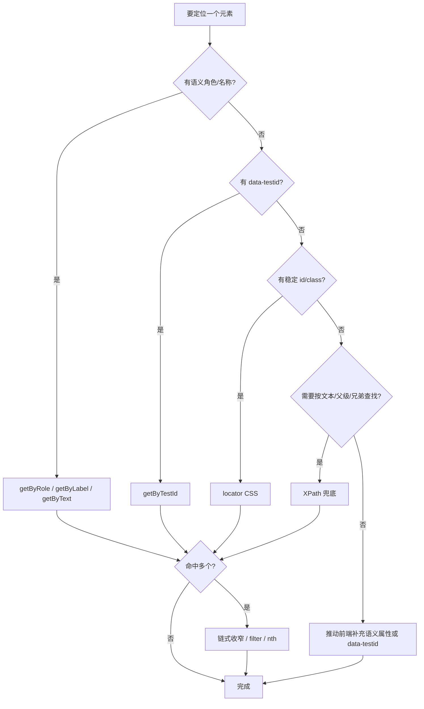

UI 自动化的稳定性，八成取决于**元素定位**。定位器写得好，页面改版脚本依旧能跑；定位器写得差，一次文案改动就让整条流水线飘红。这篇文档以 Playwright 为例，系统整理元素定位的全部方式——从最推荐的角色定位到兜底的 XPath，并解释那些"看起来差不多"的能力到底差在哪。

[[TOC]]

## 核心原则：面向用户行为定位

先给出结论，后面所有内容都围绕它展开：

1. **优先用语义化定位**（`getByRole`、`getByLabel`、`getByText`），它们最接近用户真实感知页面的方式；
2. **其次用测试专用属性**（`data-testid`），它是团队约定的稳定锚点；
3. **CSS / XPath 是兜底手段**，只在语义属性都不存在时使用；
4. **绝不依赖实现细节**（第 N 个子元素、动态生成的 class、自动化属性如 `aria-describedby=":r1:"`）。

::: tip 为什么语义定位更稳
用户点按钮时看到的是"登录"两个字和它的角色，而不是 DOM 的第几层第几个节点。前端重构经常改 DOM 结构但保留可访问性语义——语义定位天然免疫这类重构。
:::

## 一、Playwright 内置定位器（Locator API）

Playwright 官方推荐全部通过 `page.locator()` 的语义化变体定位，按**常用到不常用**排列：

| 常用度 | 定位方式 | 示例 | 匹配目标 | 适用场景 |
| :-: | :-- | :-- | :-- | :-- |
| ★★★★★ | `getByRole` | `page.getByRole('button', { name: '提交' })` | ARIA 角色 + 可访问名称 | 绝大多数交互元素的首选 |
| ★★★★★ | `getByTestId` | `page.getByTestId('submit-btn')` | `data-testid` 属性值 | 团队约定测试锚点 |
| ★★★★ | `getByLabel` | `page.getByLabel('用户名')` | 关联 `<label>` 的表单控件 | 输入框、下拉框 |
| ★★★★ | `getByPlaceholder` | `page.getByPlaceholder('请输入手机号')` | placeholder 文本 | 无 label 时的输入框 |
| ★★★★ | `getByText` | `page.getByText('欢迎回来')` | 元素包含的文本 | 静态文本、链接文字 |
| ★★★ | `getByTitle` | `page.getByTitle('删除')` | `title` 属性（悬停提示） | 图标按钮的提示文字 |
| ★★★ | `getByAltText` | `page.getByAltText('验证码')` | `img` 的 `alt` 属性 | 图片 |
| ★★ | `locator(css)` | `page.locator('.submit-btn')` | CSS 选择器 | 无语义属性时的兜底 |
| ★ | `locator(xpath=…)` | `page.locator('xpath=//button[@type="submit"]')` | XPath 表达式 | 文本方向、父级/兄弟查找等 CSS 做不到的场景 |

```ts title="locator-basic.ts"
import { test } from '@playwright/test';

test('登录流程', async ({ page }) => {
  await page.goto('https://example.com/login');

  // 语义化定位：读起来就像用户操作手册
  await page.getByLabel('用户名').fill('alice');
  await page.getByLabel('密码').fill('secret');
  await page.getByRole('button', { name: '登录' }).click();

  // 断言也用同一套定位器
  await expect(page.getByText('欢迎回来')).toBeVisible();
});
```

### `getByRole` 的 name 匹配细节

`name` 选项默认是**不区分大小写的子串匹配**，需要精确匹配时加 `exact: true`：

```ts title="role-name.ts"
// 匹配 "提交订单"、"确认提交" 等所有包含 "提交" 的按钮 —— 可能命中多个
await page.getByRole('button', { name: '提交' }).click();

// 只匹配可访问名称恰好为 "提交" 的按钮（区分大小写、全字匹配）
await page.getByRole('button', { name: '提交', exact: true }).click();
```

常用角色速查：`button`、`link`、`textbox`、`checkbox`、`radio`、`combobox`（下拉）、`tab`、`dialog`（模态框）、`heading`（配合 `level` 选项）、`listitem`、`menuitem`、`option`。完整列表见 [ARIA Roles](https://www.w3.org/TR/html-aria/)。

### 定位器的链式过滤

定位器是惰性的（定位不立即执行），支持链式缩小范围，这是处理复杂页面的关键技巧：

```ts title="locator-chain.ts"
// 先锁定某个列表项，再在其中找按钮 —— 而不是写一条巨型选择器
const row = page.getByRole('listitem').filter({ hasText: '订单 1001' });
await row.getByRole('button', { name: '删除' }).click();

// filter 的三种姿势
await page.getByRole('listitem').filter({ hasText: '置顶' });            // 文本包含
await page.getByRole('listitem').filter({ has: page.getByText('置顶') }); // 含匹配子元素
await page.getByRole('listitem').filter({ hasNot: page.getByText('草稿') }); // 排除

// nth() 取第几个匹配项（从 0 开始）
await page.getByRole('listitem').nth(0);   // 第一个
await page.getByRole('listitem').last();   // 最后一个
```

## 二、CSS 定位模式

CSS 选择器由浏览器原生解析，**速度快、语法简洁**，是 `getByRole` 之外最重要的补充。

### 2.1 常用 CSS 选择器（按常用到不常用）

| 常用度 | 选择器 | 示例 | 匹配目标 |
| :-: | :-- | :-- | :-- |
| ★★★★★ | 类选择器 | `.submit-btn` | `class` 含该值（class 可多值空格分隔） |
| ★★★★★ | ID 选择器 | `#username` | `id="username"` |
| ★★★★ | 属性选择器 | `[data-testid="submit"]` | 属性精确匹配 |
| ★★★★ | 后代组合器 | `.modal .title` | 后代中所有匹配（任意层级） |
| ★★★ | 子代组合器 | `.form > .field` | 仅直接子元素 |
| ★★★ | 标签选择器 | `input[type="checkbox"]` | 标签 + 属性过滤 |
| ★★ | 相邻兄弟 | `.label + input` | 紧邻其后的一个兄弟 |
| ★★ | 通用兄弟 | `.label ~ input` | 其后的所有兄弟 |
| ★★ | 伪类 | `:checked`、`:disabled`、`:focus` | 元素状态 |
| ★ | 伪类函数 | `:nth-child(2)`、`:nth-of-type(1)` | 按位置匹配 |
| ★ | 通配符 | `div *` | 任意后代元素 |

### 2.2 属性选择器的匹配语法

属性选择器不止 `=` 一种，完整能力如下：

| 语法 | 示例 | 含义 |
| :-- | :-- | :-- |
| `[attr=v]` | `[type="text"]` | 精确等于 |
| `[attr~=v]` | `[class~="active"]` | 空格分隔的词列表中包含 |
| `[attr^=v]` | `[href^="https"]` | 以 v 开头 |
| `[attr$=v]` | `[src$=".png"]` | 以 v 结尾 |
| `[attr*=v]` | `[href*="detail"]` | 包含子串 |
| `[attr]` | `[disabled]` | 只要属性存在（无论值） |

```ts title="css-locator.ts"
// Playwright 中 CSS 是 locator() 的默认语法
await page.locator('.search-input input[type="search"]').fill('playwright');
await page.locator('[data-testid="row"]:has(.status-pending)').click(); // 见下文 :has

// css= 前缀可省略，写出来仅用于显式区分
await page.locator('css=.submit-btn').click();
```

### 2.3 Playwright 对 CSS 的扩展

Playwright 在标准 CSS 之上增加了几个引擎扩展，**注意它们只在 Playwright 里可用，不能照搬到浏览器 DevTools**：

| 扩展 | 示例 | 说明 |
| :-- | :-- | :-- |
| `:has-text("…")` | `.row:has-text("置顶")` | 匹配**自身或后代**包含该文本的元素 |
| `:text("…")` | `a:text("登录")` | 匹配包含该文本的最小元素 |
| `:text-is("…")` | `:text-is("登录")` | 文本精确匹配（区别见下节） |
| `:has(…)` | `.row:has(.badge)` | 匹配**后代中**含匹配元素的元素（与标准 `:has()` 一致） |
| `:visible` | `.modal:visible` | 只匹配可见元素 |
| `:nth-match(…, n)` | `:nth-match(:text("删除"), 2)` | 第 n 个匹配项（与 CSS 的 `nth-child` 不同，见下节） |

## 三、XPath 定位模式

XPath 是 XML 路径语言，能力比 CSS 强（能向上找父级、按文本找、跨层级取值），但**语法冗长、执行更慢、容易写出脆弱定位**。定位 CSS 搞不定的结构时再用。

### 3.1 常用 XPath 表达式（按常用到不常用）

| 常用度 | 表达式 | 示例 | 匹配目标 |
| :-: | :-- | :-- | :-- |
| ★★★★★ | 属性匹配 | `//input[@id='username']` | 任意层级的 input 且 id 匹配 |
| ★★★★★ | 文本匹配 | `//button[text()='登录']` | 文本**完全等于** |
| ★★★★ | 文本包含 | `//span[contains(text(), '订单')]` | 文本包含子串 |
| ★★★★ | 属性包含 | `//div[contains(@class, 'modal')]` | 属性值包含子串 |
| ★★★ | 相对路径 | `.//li` | 当前节点下的后代（. 不可省略） |
| ★★★ | 父级轴 | `//span[text()='订单']/..` 或 `parent::div` | 向上找父元素（CSS 做不到） |
| ★★ | 索引 | `//ul/li[2]` | 第 2 个 li（XPath 索引从 1 开始） |
| ★★ | 兄弟轴 | `following-sibling::td[1]` | 其后的兄弟节点 |
| ★★ | 祖先轴 | `ancestor::div[@class='row']` | 任意层级的祖先 |
| ★ | 逻辑组合 | `//input[@type='text' and @name='q']` | 多条件与（还有 `or`、`not()`） |
| ★ | 通配符 | `//*[@data-testid]` | 任意标签但含该属性 |

### 3.2 XPath 使用示例

```ts title="xpath-locator.ts"
// Playwright 中 XPath 需要显式声明（或以 // 开头自动识别）
await page.locator("//button[@type='submit']").click();
await page.locator('xpath=//div[contains(@class, "dropdown")]//a[text()="导出"]').click();

// 经典场景：按单元格文本定位，再横向取同行的按钮（CSS 无法表达）
await page.locator("//td[normalize-space()='订单 1001']/following-sibling::td//button[contains(., '删除')]").click();

// 向上找父级再回来（"本文本所在卡片的删除按钮"）
await page.locator("//h3[contains(., '优惠券')]//ancestor::div[contains(@class, 'card')]//button[@aria-label='删除']").click();
```

### 3.3 XPath 文本函数的区别

| 函数 | 匹配方式 | 空白处理 |
| :-- | :-- | :-- |
| `text()='登录'` | 完全相等 | 严格，首尾空格即失配 |
| `.='登录'` | 元素**整个字符串值**完全相等 | 严格 |
| `contains(text(), '登')` | 子串包含 | 不处理空白 |
| `contains(., '登')` | 元素及**所有后代**文本的拼接包含子串 | 不处理空白 |
| `normalize-space()='登录'` | 完全相等 | 先压缩空白并去首尾，最稳 |
| `starts-with(text(), '订单')` | 前缀匹配 | 不处理空白 |

## 四、相近能力的区别辨析

这是最容易踩坑的部分：同一个目标往往有多个可达的定位方式，选错的对象往往"平时能跑，一改版就挂"。

### 4.1 `getByText` vs `getByRole(name)` vs `:text()`

| 维度 | `getByRole('button', { name: '登录' })` | `getByText('登录')` | CSS 扩展 `:text('登录')` |
| :-- | :-- | :-- | :-- |
| 匹配范围 | 只有按钮角色，且按**可访问名称**（含 `aria-label`、`title`）匹配 | 任何文本匹配的元素 | 任何文本匹配的最小元素 |
| 命中"登录"两个字在 `<div>` 里 | 不命中（div 不是 button） | 命中 div | 命中 div |
| 按钮 `aria-label="提交"`、文本是图标 | **命中**（读的是可访问名称） | 不命中 | 不命中 |
| 表达的意图 | "用户视角的那个按钮" | "页面上这段文字" | 同左，语法糖 |

结论：**点按钮用 `getByRole`，断言文字用 `getByText`**。`aria-label` 覆盖了无文字的图标按钮，这是 `getByText` 永远做不到的。

### 4.2 `:has-text()` vs `:has()` vs `filter({ hasText })`

三者都能表达"包含某内容的容器"，但匹配对象不同：

```ts title="has-diff.ts"
// :has-text() —— 匹配的是"自己或后代包含该文本"的元素，最终选中 .row 本身
await page.locator('.row:has-text("置顶")').click();

// :has() —— 匹配"后代中存在匹配选择器的元素"，参数是选择器不是文本
await page.locator('.row:has(.badge-warning)').click();

// filter({ hasText }) —— 等价于 :has-text()，但可以接在语义定位器后面
await page.getByRole('listitem').filter({ hasText: '置顶' }).click();
```

三者结果常常相同，优先级：**链式 `filter`（可读性最好，能接语义定位器）> `:has()`（组合选择器时）> `:has-text()`（纯 CSS 字符串里）**。

### 4.3 `getByTestId` vs `data-testid` CSS 属性选择器

```ts
// 两者等价，但 getByTestId 受 testIdAttribute 配置控制（默认 data-testid）
await page.getByTestId('submit');
await page.locator('[data-testid="submit"]');

// 需要换属性名时只改一处配置
// playwright.config.ts: use: { testIdAttribute: 'data-qa' }
```

结论：统一用 `getByTestId`，让属性名成为可配置项而非散落各处的硬编码。

### 4.4 CSS `nth-child` vs `nth-of-type` vs Playwright `nth()` vs XPath `li[2]`

四个"按位置取"的能力，计数规则各不相同：

| 写法 | 计数基准 | 索引起点 |
| :-- | :-- | :-- |
| `:nth-child(2)` | **所有兄弟**中的第 2 个，且须同时满足前面的选择器 | 1 |
| `:nth-of-type(2)` | 同**标签类型**的兄弟中第 2 个 | 1 |
| `.locator('li').nth(1)` | **匹配结果集**中的第 1 个（先匹配后取位） | 0 |
| `//ul/li[2]` | 匹配结果集中的第 2 个（先匹配后取位） | 1 |

```html title="结构差异示例.html"
<ul>
  <li>甲</li>          <!-- nth-child(1) / nth-of-type(1) / nth(0) -->
  <p>插入段</p>        <!-- nth-child(2)：p 抢了这个位置 -->
  <li>乙</li>          <!-- nth-child(3)，nth-of-type(2)，nth(1) -->
</ul>
```

结论：**优先 `nth()`**——它基于"过滤后的结果集"计数，不受无关兄弟元素干扰；CSS 位置伪类只在写纯 CSS 字符串时使用。

### 4.5 `text()` vs `contains(text())` vs `normalize-space()`

见 3.3 的表格。补充一个高频翻车场景：前端模板渲染常在文本前后留下换行和空格，导致 `text()='登录'` 静默失配：

```ts title="normalize-space.ts"
// 模板里写的是 <button>\n  登录\n</button>
await page.locator("//button[text()='登录']");        // 失配！首尾有空白
await page.locator("//button[normalize-space()='登录']"); // 命中，空白已清理
```

### 4.6 `locator` vs `getByRole` 之外的旧 API

从 Selenium 时代过来的代码常见 `page.$()`、`page.waitForSelector()`、`textContent()` 这类旧 API，它们与 Locator 的本质区别：

| 维度 | Locator（新） | `page.$()` / ElementHandle（旧） |
| :-- | :-- | :-- |
| 执行时机 | 惰性，每次操作时重新查询 | 立即查询，拿到**快照** |
| DOM 重建后 | 自动重新定位，天然抗重渲染 | 句柄可能指向已删除节点，操作报错 |
| 自动等待 | 内置（actionability 检查） | 无，需手动 `waitForSelector` |
| 官方态度 | 推荐 | 已不推荐用于新代码 |

结论：**新代码一律用 Locator**。旧代码里的 ElementHandle 迁移通常只需把 `$()` 换成 `locator()`。

## 五、进阶定位技巧

### 5.1 严格模式与"命中多个"的处理

Playwright 默认严格模式：一个定位器命中多个元素时，`click()` 等操作直接抛错（这是保护，不是 bug）。处理方式按优先级：

```ts title="strict-mode.ts"
// 1. 收窄定位（首选）
await page.getByRole('dialog').getByRole('button', { name: '确认' }).click();

// 2. 语义化 nth —— 配合注释说明为什么取这个
await page.getByRole('listitem').filter({ hasText: '置顶' }).nth(0);

// 3. 确实想"点所有匹配项"
const buttons = page.getByRole('button', { name: '删除' });
const count = await buttons.count();
for (let i = 0; i < count; i++) {
  await buttons.nth(i).click(); // 注意：删除会改变列表，必须每次重新取 nth
}

// 4. .first() 是 nth(0) 的语法糖，只在"明确只要第一个"时用
await page.getByRole('button', { name: '删除' }).first().click();
```

### 5.2 在 iframe / shadow DOM 中定位

Playwright 的定位器**默认穿透 iframe 与 open shadow DOM**，这是相对 Selenium 的巨大优势：

```ts title="frame-shadow.ts"
// open shadow DOM：直接穿透，无需特殊处理
await page.locator('my-dialog').getByRole('button', { name: '关闭' }).click();

// iframe：frameLocator 之后的定位器在该 frame 内解析
await page.frameLocator('#payment-iframe').getByLabel('卡号').fill('4242...');

// closed shadow DOM 无法穿透 —— 这是唯一需要动产品代码的场景：
// 请求前端提供 data-testid，或在 E2E 构建时打开 shadow root
```

### 5.3 定位动态 class 与样式驱动的组件

组件库（Element Plus、Ant Design）常生成 `el-button--primary ant-btn-css-var` 这类实现细节 class，以及 `:r1:` 这类自动化的 aria 属性。它们随时会变，**不可作为定位锚点**。正确姿势：

```ts title="unstable-selectors.ts"
// 差：绑死实现细节，组件库升级即挂
await page.locator('.ant-btn-css-var.ant-btn-primary');

// 好：语义或测试锚点
await page.getByRole('button', { name: '提交' });
await page.getByTestId('submit-btn');

// 确实只能靠结构区分时，选择稳定的结构特征而非样式特征
await page.locator('form button[type="submit"]');
```

### 5.4 自动等待与定位的关系

Locator 的每一步操作（`click`、`fill`、`check`）都内置 actionability 等待：等元素**可见、稳定、可交互**后才执行。因此绝大多数"sleep 大法"都可以删掉：

```ts title="auto-wait.ts"
// 差：魔法等待，慢且不可靠
await page.waitForTimeout(3000);
await page.getByRole('button', { name: '提交' }).click();

// 好：断言即等待 —— toBeVisible 默认重试至超时
await expect(page.getByText('保存成功')).toBeVisible();

// 定位器本身不会等待 DOM 出现，但操作会；需要"等到元素出现"用 waitFor
await page.getByRole('dialog').waitFor({ state: 'visible' });

// 反向等待：等元素消失（动画结束、路由跳转后）
await expect(page.getByRole('dialog')).toBeHidden();
```

### 5.5 调试定位器的工具链

写定位器不必盲试，Playwright 提供了完整的调试链路：

| 工具 | 命令 / 用法 | 用途 |
| :-- | :-- | :-- |
| Playwright Inspector | `npx playwright test --debug` | 逐步执行，实时显示每个定位器的命中框 |
| Codegen | `npx playwright codegen example.com` | 录制操作，自动生成**语义化定位器**的代码 |
| VS Code 扩展 | Playwright Test for VSCode | 编辑器内点选元素生成定位器、运行单个用例 |
| `locator.evaluate` | `await page.locator(sel).evaluate(el => el.outerHTML)` | 打印命中元素的 HTML，确认定位是否命中预期的那个 |
| DevTools Console | `document.querySelectorAll('.x').length` | 手工验证 CSS；XPath 用 `$x('//button')` |

```ts title="debug-locator.ts"
// 快速自检：这个定位器命中了几个？分别是什么？
const items = page.locator('.result-item');
console.log(await items.count());
console.log(await items.first().evaluate(el => el.outerHTML));
```

### 5.6 为可定位性推动前端协作

定位问题的最优解常常不在测试侧，而在协作约定：

:::: card-grid

::: card title="约定 data-testid" icon="mdi:identifier"
只在自动化需要锚点处添加，命名用 kebab-case 语义化名称（`submit-btn`、`order-row-0` 的容器 `order-list`），不与样式耦合。
:::

::: card title="保留可访问性" icon="mdi:accessibility"
`aria-label`、`<label for>`、语义化标签（`button` 而非 `div.onclick`）既服务无障碍也服务定位，是双赢投入。
:::

::: card title="稳定 DOM 契约" icon="mdi:file-certificate"
把测试依赖的 DOM 结构（列表容器、key 属性、稳定 `id`）纳入 code review 范围，改动前同步测试侧。
:::

::::

## 六、选择定位方式的决策流



## 总结

- 定位优先级：**语义角色 → 测试锚点 → CSS → XPath**，越靠后越脆弱；
- `getByRole` 读的是可访问名称，`getByText` 读的是渲染文本，图标按钮只有前者能覆盖；
- `nth()` 基于结果集计数，优于 CSS 位置伪类；`normalize-space()` 是 XPath 文本匹配的默认选择；
- Locator 惰性重查询 + 自动等待，取代一切 ElementHandle 与 sleep；
- 命中多个时严格模式报错是保护，收窄定位优于取下标；
- 最持久的稳定性来自与前端的协作约定，而不是更聪明的选择器。
